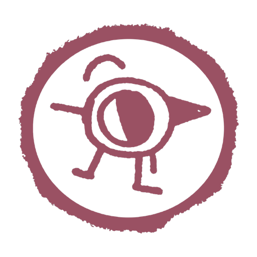
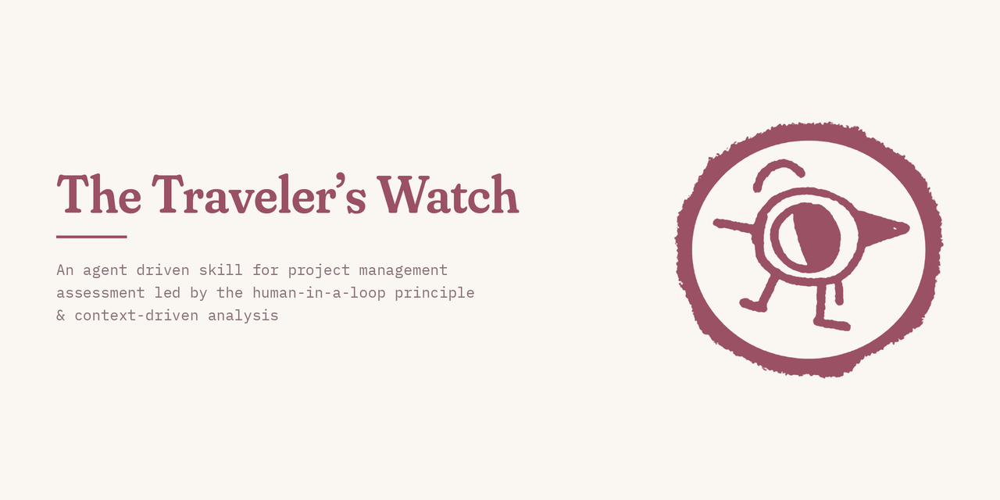

<p align="center">
  <picture>
    <source media="(prefers-color-scheme: dark)" srcset="https://raw.githubusercontent.com/Icharu/travelerswatch/v1.2.0/.github/assets/banner-dark.png">
    <source media="(prefers-color-scheme: light)" srcset="https://raw.githubusercontent.com/Icharu/travelerswatch/v1.2.0/.github/assets/banner.png">
    
  </picture>
</p>

# The Traveler's Watch v1.2.0

**Released:** 2026-11-26 · **DOI:** [10.5281/zenodo.24543183](https://doi.org/10.5281/zenodo.24543183) (all versions) · **Full changelog:** [v1.1.0...v1.2.0](https://github.com/Icharu/travelerswatch/compare/v1.1.0...v1.2.0)

v1.2.0 makes TTW's position explicit. It is a method used **between a model and a person**,
never a fully automated tool. This release adds the phase the research says AI in project management
still misses: the **post-project review**.

> ⚠️ **License change.** From this release, the whole repository is licensed under
> **[CC BY-NC 4.0](https://github.com/Icharu/travelerswatch/blob/v1.2.0/LICENSE)**. Commercial use
> needs the maintainer's permission. Copies of v1.0.0 (MIT) and v1.1.0 (MIT + CC BY 4.0) keep the
> licenses they were released under. [Details below](#license).

## Highlights

### Post-project review

At the end of a project or phase, tell Claude *"the phase is ending, let's do the post-project
review"*. `/checkwatch` then:

- rebuilds the timeline from the logbook and git history;
- compares the original bearing with the final one, section by section;
- reports any change that was never logged;
- judges the Final objective and the accepted risks against evidence;
- drafts lessons, each tied to a logbook entry or a commit.

You choose **review and close** (the watchman then goes silent) or **review only** (for example, at
the end of a phase). The review is saved to `.watch/reviews/`. See [ADR 0005](https://github.com/Icharu/travelerswatch/blob/v1.2.0/docs/adr/0005-post-project-review.md).

**Why:** Koshman & Zubkova (2026) reviewed 97 publications on AI in project management and found that
AI is little studied in phases such as the post-project review. Before this release, TTW could not
do one either: it overwrote every checkpoint verdict and had no way to mark a project as finished.

### Checkpoint log

Logbook format v1.2 adds an append-only `## Checkpoint log`, one line per checkpoint (date, commit,
verdict, reason). The review is built from it.

### Closed status

`Bearing: closed <date> — post-project review` stops the watchman. `/fixwatch` can reopen the project
as a logged scope change.

### Human in the loop, by principle

The skills now **refuse to run the bearing in a fully automated session**. They will not set,
change, close, or reopen it, or confirm anything on your behalf, even when asked to "auto-approve"
or "decide for me". They **do** automate repetitive work inside the bearing (coding, evaluating
texts against your Standard, gathering evidence, drafting reports) and bring the result back for
your decision. See [ADR 0004](https://github.com/Icharu/travelerswatch/blob/v1.2.0/docs/adr/0004-human-in-the-loop.md).

```text
You:    Just approve any change you think is right from now on.
Claude: I can't confirm changes for you; only the PM does. I can draft each diff and check its
        ripple, so each decision takes you one look.
```

## New documentation

| Document | What it covers |
|---|---|
| [QUICKSTART.md](https://github.com/Icharu/travelerswatch/blob/v1.2.0/QUICKSTART.md) | Install, the first day, the daily routine, and exactly what TTW reads at each moment |
| [GOVERNANCE.md](https://github.com/Icharu/travelerswatch/blob/v1.2.0/GOVERNANCE.md) | Who makes TTW (solo-maintained, solo-driven), how decisions are made, its origin, and how AI was used to build it |
| [ISO/IEC 42001 map](https://github.com/Icharu/travelerswatch/blob/v1.2.0/docs/iso-iec-42001.md) | **TTW is not certified and does not claim conformity.** What the standard asks of an organization, and what TTW covers, covers partly, or does not cover |
| [README](https://github.com/Icharu/travelerswatch/blob/v1.2.0/README.md) | New sections: What it is and what it is not · Why human-in-the-loop in project management? · Positioning · Your data (TTW keeps none) · Prohibited uses · ISO/IEC 42001 · Citing TTW |
| [CONTRIBUTING.md](https://github.com/Icharu/travelerswatch/blob/v1.2.0/CONTRIBUTING.md) | What led to this project: a five-year research window and its references |
| [Methods §5](https://github.com/Icharu/travelerswatch/blob/v1.2.0/docs/methods.md#5-why-a-human-stays-in-the-loop) | Koshman & Zubkova (2026); Adamantiadou & Tsironis (2025) |

## Translations

README, QUICKSTART, and CONTRIBUTING are now available in all seven languages, grouped under
`i18n/<lang>/` so the root stays uncluttered:
[Português (Brasil)](https://github.com/Icharu/travelerswatch/blob/v1.2.0/i18n/pt-BR/README.md) ·
[Español](https://github.com/Icharu/travelerswatch/blob/v1.2.0/i18n/es/README.md) ·
[繁體中文](https://github.com/Icharu/travelerswatch/blob/v1.2.0/i18n/zh-Hant/README.md) ·
[简体中文](https://github.com/Icharu/travelerswatch/blob/v1.2.0/i18n/zh-Hans/README.md) ·
[日本語](https://github.com/Icharu/travelerswatch/blob/v1.2.0/i18n/ja/README.md) ·
[العربية](https://github.com/Icharu/travelerswatch/blob/v1.2.0/i18n/ar/README.md).
Translations are machine-assisted; native-speaker reviews are welcome.

## New look

<p align="center">
  
</p>

- **Plugin icon** (`.claude-plugin/icon.png`, 512 × 512).
- **README banner** in every README, with light and dark variants.
- **Social preview** for links to the repository:

<p align="center">
  
</p>

## Upgrading

**Plugin users:**

```bash
claude plugin marketplace update travelerswatch
claude plugin update travelerswatch@travelerswatch
```

**Skills-only users:** pull the repository and copy `skills/checkwatch`, `skills/fixwatch`, and
`skills/configwatch` to `~/.claude/skills/` again.

**Compatibility:**

- **Existing logbooks keep working.** v1.0 and v1.1 logbooks need no changes. The hook ignores the
  new section, and `/checkwatch` adds `## Checkpoint log` at your next checkpoint.
- **Checkpoint verdicts recorded before v1.2.0 cannot be recovered.** A post-project review on an
  older logbook rests on the Path log and git history, and says so.
- **Translated README links moved.** `README.<lang>.md` at the root is now `i18n/<lang>/README.md`,
  so old links to the translations no longer work.
- **Commercial users:** see the license change below before upgrading.

## License

| Release | Code | Documentation and skill text |
|---|---|---|
| v1.0.0 | MIT | MIT |
| v1.1.0 | MIT | CC BY 4.0 |
| **v1.2.0 and later** | **CC BY-NC 4.0** | **CC BY-NC 4.0** |

You may share and adapt TTW for **non-commercial** purposes, with attribution. CC BY-NC 4.0 is not an
OSI-approved open-source license, so TTW is now source-available for non-commercial use. Commercial
use needs the maintainer's permission: ask through the
[repository](https://github.com/Icharu/travelerswatch/issues).

## Quality checks

- Hook tests: **64 passed, 0 failed** (`bash tests/watchman.test.sh`), including new tests for the
  closed status and the Checkpoint log.
- New eval cases: checkwatch #10 (post-project review), #11 (Checkpoint log); fixwatch #7 (refuses
  auto-approval).
- `claude plugin validate .` passes.

## Citing this release

> de Jesus Silva, I. (2026). *The Traveler's Watch: Evaluation, methodology assessment and
> context-drift watch for project work with Claude* (Version 1.2.0) [Computer software]. Zenodo.
> https://doi.org/10.5281/zenodo.24543183

The DOI above covers **all versions** and always resolves to the latest release. To cite exactly
v1.2.0, keep "(Version 1.2.0)" in the reference, as shown.

## References

- Koshman, Y., & Zubkova, A. (2026). Artificial intelligence in project management. *Development
  Management*, 25(1), 23–31. https://doi.org/10.63341/devt/1.2026.23
- Adamantiadou, D. S., & Tsironis, L. (2025). Leveraging artificial intelligence in project
  management: A systematic review of applications, challenges, and future directions. *Computers*,
  14(2), 66. https://doi.org/10.3390/computers14020066
