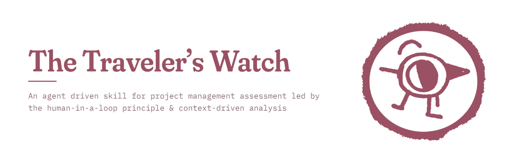

  <picture>
    <source media="(prefers-color-scheme: dark)" srcset="https://raw.githubusercontent.com/Icharu/travelerswatch/v1.2.1/.github/assets/banner-dark.png">
    <source media="(prefers-color-scheme: light)" srcset="https://raw.githubusercontent.com/Icharu/travelerswatch/v1.2.1/.github/assets/banner.png">
    
  </picture>

# The Traveler's Watch v1.2.1

**Released:** 2026-11-26 · **DOI:** [10.5281/zenodo.24548859](https://doi.org/10.5281/zenodo.24548859) (this version) · [10.5281/zenodo.24543183](https://doi.org/10.5281/zenodo.24543183) (all versions) · **Full changelog:** [v1.2.0...v1.2.1](https://github.com/Icharu/travelerswatch/compare/v1.2.0...v1.2.1)

A **documentation-only** release. Skills, hook, logbook format, and license are the same as
[v1.2.0](v1.2.0.md); nothing changes for people already on v1.2.0.

## What's in it

- **Release notes for v1.2.0** in [`docs/releases/v1.2.0.md`](https://github.com/Icharu/travelerswatch/blob/v1.2.1/docs/releases/v1.2.0.md).
- **Citation:** the READMEs and `CITATION.cff` cite v1.2.0 with the all-versions DOI
  ([10.5281/zenodo.24543183](https://doi.org/10.5281/zenodo.24543183)), replacing the "pending" DOI rows.

## Known issues

- **Version number.** The plugin manifests, skill metadata, `CITATION.cff` and `.zenodo.json` in this
  release still say **1.2.0**, so the Zenodo record shows "1.2.0". The archive itself is
  `travelerswatch-v1.2.1.zip`, and the DOI above belongs to this release.
- **Translated tale not included.** The translations of the tale into six languages were not pushed
  before this release was published, so they are not part of v1.2.1. They are on `main` and will be
  in the next release.

## Upgrading

Nothing to do if you are on v1.2.0. From an earlier version, follow the upgrade notes in
[v1.2.0](v1.2.0.md#upgrading).

## Citing this release

> de Jesus Silva, I. (2026). *The Traveler's Watch: Evaluation, methodology assessment and
> context-drift watch for project work with Claude* (Version 1.2.1) [Computer software]. Zenodo.
> https://doi.org/10.5281/zenodo.24548859

To cite the project in general rather than this exact release, use the all-versions DOI,
[10.5281/zenodo.24543183](https://doi.org/10.5281/zenodo.24543183), which always resolves to the
latest release.

| Release | DOI |
|---|---|
| All versions | [10.5281/zenodo.24543183](https://doi.org/10.5281/zenodo.24543183) |
| v1.2.1 | [10.5281/zenodo.24548859](https://doi.org/10.5281/zenodo.24548859) |
| v1.2.0 | [10.5281/zenodo.24548668](https://doi.org/10.5281/zenodo.24548668) |
| v1.1.0 | [10.5281/zenodo.24543326](https://doi.org/10.5281/zenodo.24543326) |
| v1.0.0 | [10.5281/zenodo.24543184](https://doi.org/10.5281/zenodo.24543184) |
